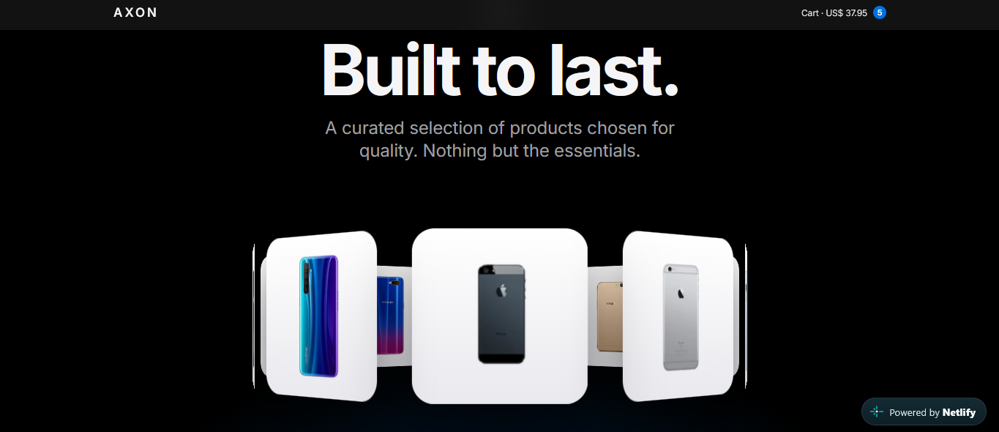

# AXON Store

A modern e-commerce front-end built with React and TypeScript, featuring a 3D product ring, physics-based animations and a persistent shopping cart, offering a lightweight and accessible experience.

**🔗 Live demo:** [axonx-store.netlify.app](https://axonx-store.netlify.app/)



## Features

- **Product catalog** with search, category filter based on your interests and reviews.
- **Product detail page** with dynamic routes (`/product/:id`)
- **Shopping cart** shared across the app with the Context API, based on your tastes
- **Persistent cart** saved in `localStorage` (survives page reloads)
- **Animations with GSAP:** making your experience relaxed
  - Draggable 3D product ring with inertia
  - 3D tilt cards that follow the mouse
  - Products "fly" to the cart, with physics-based particles
  - Scroll-triggered reveals and smooth page transitions
- **Accessible motion:** all animations respect the `prefers-reduced-motion` setting
- **Responsive** layout for desktop and mobile

## Tech stack

| Category | Tools |
| --- | --- |
| Framework | React 19, TypeScript |
| Build tool | Vite, Bun |
| Routing | React Router |
| State | Context API, `localStorage` |
| Animations | GSAP (ScrollTrigger, SplitText, Draggable, Inertia, Physics2D) |
| Data | [DummyJSON API](https://dummyjson.com) |
| Deploy | Netlify |

## Getting started

You will need [Bun](https://bun.sh) installed.

```bash
# clone the repository
git clone https://github.com/ThiagoGregorio13/loja-react.git
cd loja-react

# install dependencies
bun install

# start the dev server
bun run dev
```

Then open http://localhost:5173 in your browser.

## Project structure

```
src/
├── animations/   # GSAP setup and reusable animation hooks
├── context/      # Cart context and provider
├── hooks/        # Data-fetching hooks (useProducts, useProduct, useCategories)
├── pages/        # Store, ProductDetail and Cart pages
└── types.ts      # Shared TypeScript types
```


## What I learned

- **Custom hooks** to separate data fetching from the UI, with loading and error states
- **Avoiding race conditions** in `useEffect` with an `ignore` flag in the cleanup function
- **Removing prop drilling** by moving the cart into a Context with a custom `useCart()` hook
- **Lazy initialization** of `useState` to read `localStorage` only once
- **Client-side routing** with React Router, including dynamic params and the Netlify redirect needed for page reloads
- **Animating React components** with GSAP's `useGSAP` hook, with proper cleanup

## Author

Made by **Thiago Gregorio** · [GitHub](https://github.com/ThiagoGregorio13)